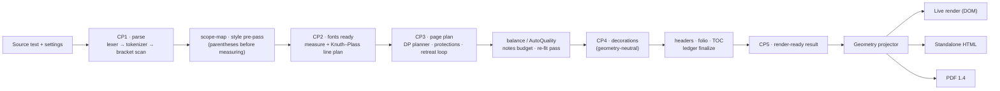

# Architecture

This document mirrors `main` at commit `6f80156` (the engine code is identical to `510c9d6`; the commits in between touch only workflows and documents). Statements are **code-level evidence** — read from the source at that commit (master plan §2.3) — and do not prove that the output is correct; acceptance is tracked by gates G0–G7 in [coordination/AGENT_TRACKING.md](coordination/AGENT_TRACKING.md). Open PR #33 (not merged) adds a source-structure validator to the pipeline (D-100); see the note at the end. File paths are relative to `red-build/src/` unless stated otherwise.

## 1. Overview

RED is a **pure function plus a UI around it**: `typeset(text, settings)` turns a source text and a complete settings object into a layout result. The engine is plain CommonJS JavaScript with **no runtime dependencies**, has no randomness and no wall-clock input, and therefore produces the same layout for the same input (`layoutHash`, SHA-256). In the browser the engine runs inside a **Web Worker**; the UI shell talks to it through a small versioned message protocol ([API.md](API.md)).

## 2. The pipeline (`engine/core/pipeline.js`)

The order of operations is fixed and enforced in one place, with five named checkpoints:

Invariants that the pipeline proves on every run:

- **Content preservation** (`contentPreserved`): the words in the source and the words in the output are accounted for from the same computed representation, in every notes mode (footnotes, endnotes, side notes) and with decorations on.
- **Geometry neutrality** (`geometryNeutralVerified`): the decoration pass (CP4) must not change the measured body geometry; this is verified with `bodyGeometryHash` (CP4 == CP5).
- **Determinism** (`layoutHash`): SHA-256 over the canonical page structure (page index and type, the token id and words of every line in every column, footnote and side-note counts). Progress reporting (`onProgress`) is instrumentation only and must not change the hash — this is enforced by a test.

### Two layout paths

`typeset()` normally runs the pipeline above. When the settings carry `_layout-profile: 'imud'` and the raw JSON of the original software's settings (`_imudRaw`, produced by `importImudSettings`), it delegates to `legacyTypeset` in `engine/layout/legacy-imud-flow.js` — a faithful port of the original layout engine, kept to compare against the original software's output (`audits/layout-reference.json`, `tools/layout-parity/`). Per D-98 (open PR #33) that comparison is a historical diagnostic, not an acceptance target.

## 3. Module map

| Layer | Modules (`engine/…`) | Responsibility |
|---|---|---|
| Parser | `parser/dfa-lexer.js`, `block-tokenizer.js`, `bracket-scanner.js` | Metadata recognised only in the preamble; headings H0–H7, paragraphs, endnotes and editorial `##…##` tokens; balanced `[...]` footnote scanning |
| Typography | `typography/measure-api.js`, `measure-table.js`, `font-metrics.js`, `font-subset.js`, `kp-linebreak.js`, `protectors.js`, `dropword.js` | Single measurement entry point and calibrated width tables; TrueType/OpenType table parser ("implementation B", selected by the `measure-impl` setting); subsetting for exports; Knuth–Plass line breaking; NBSP gluing; first-word decoration |
| Layout | `layout/dp-planner.js`, `column-flow.js`, `balancing.js`, `candidate-generator.js`, `protections-matrix.js`, `retreat-loop.js`, `ordering.js`, `headings-escort.js`, `footnote-budget.js`, `endnote-pages.js`, `side-notes.js`, `page-templates.js` | Multi-column / multi-page DP planner and `layoutHash`; column geometry; AutoQuality and global optimal balance; split-candidate scoring; protections re-run after every mutation; unified retreat loop with oscillation detector; reading-order-preserving moves; heading escort; footnote reservation; endnote pagination; side notes (H7); page-type contracts PT-01…PT-10 |
| Notes | `notes/markers.js` | One unified note-marker module |
| Decoration | `decoration/ornament-plan.js`, `dividers.js`, `shaar-pages.js`, `shaar-boxes.js`, `page-decorations.js`, `theme-sets.js`, `custom-pages.js`, `headers-builder.js`, `folio.js`, `toc-builder.js`, `numbering-audit.js`, `svg-sanitize.js`, `asset-registry.js`, `assets-import.js` | Decoration pass (L5); title ("shaar") pages and boxes; themes; custom page types; running heads; page numbering; TOC pages; numbering invariants; SVG sanitizer with an allow-list; design-asset registry and folder import |
| Output | `output/geometry-projector.js`, `legacy-projector.js`, `dom-renderer.js`, `html-export.js`, `pdf-writer.js`, `zip-writer.js`, `export-api.js`, `project-io.js`, `line-font.js`, `shaar-content.js` | CP5 model → explicit geometry; DOM rendering with a PUA-scrub invariant; standalone HTML with an offline guard; PDF 1.4 writer; deterministic ZIP writer; export orchestration; project JSON/ZIP with settings migrations |
| Extensions / import | `extensions/style-schema.js`, `apply-styles.js`, `extensions-io.js`, `import/docx-import.js`, `zip-reader.js`, `xml-lite.js` | Custom text styles (schema, trigger matching, export/import); DOCX import with its own ZIP and XML readers |
| Audit | `audit/editing-recommendations.js`, `text-edits.js`; `audit/report-schema.js`, `scanners.js` (under `src/audit/`) | Editing recommendations proven by dry-run re-layout; diagnostics report v2; anti-patcha scanners (dead-control / phantom-key / orphan-mechanism) |
| Core | `core/pipeline.js`, `settings-registry.js`, `legacy-settings-map.js`, `ledger.js`, `events.js` | Orchestration; the settings contract; mapping of the original software's settings; decision/issue ledger with lifecycle; event log (trace v2, logical clock) |

## 4. Settings contract

`core/settings-registry.js` is the single source of truth: **221 settings** (see [SETTINGS.md](SETTINGS.md)). Each entry binds a UI control, the consuming engine modules and an effect test. The scanners in `src/audit/scanners.js` fail the test chain on dead controls, phantom keys and orphan mechanisms. `tools/gen-ui-bindings.js` generates `src/ui/bindings.generated.js` (control ids, Hebrew labels, grouping) from the registry, and the settings panel is rendered from that manifest only.

## 5. UI and the Worker

- **Shell** (`ui/…`): `app-shell.js` (tabs, state, export orchestration), `editor-tab.js`, `settings-panel.js`, `testing-tab.js`, `preview-tab.js`, `status-strip.js`, `extensions-panel.js`, `imud-library.js`, `settings-persistence.js`, `test-doc-generator.js`, `caret-map.js`, `retypeset-policy.js`, `browser-entry.js`.
- **Retypeset policy:** light settings update the view directly; *heavy* settings never trigger an automatic typeset — the user presses ⚡ (rule F-06, verified by a call-graph scan `tools/scan-control-triggers.js`).
- **Worker split:** `ui/worker-client.js` (`WorkerEngineClient`: single-flight requests, progress, cancel) ↔ `ui/engine-worker-main.js` (runs `typeset()` and the export handlers) over the protocol in `ui/worker-protocol.js`. Cancelling terminates the Worker and the next request respawns it. `ui/inline-transport.js` runs the same code in-process for tests.
- **Persistence:** only the difference from the defaults is stored in `localStorage` (key `tora-red-user-settings`); defaults are always applied first.

## 6. Build and distribution

`tools/build-worker-bundle.js` is a tiny CommonJS bundler with no external dependencies. It writes two files into `red-build/ui/`:

| Bundle | Entry | Contents |
|---|---|---|
| `engine-worker.bundle.js` | `src/ui/engine-worker-main.js` | The full engine, loaded in a Web Worker |
| `app.bundle.js` | `src/ui/browser-entry.js` | The UI shell only (the engine is excluded) |

Node's `crypto` is replaced by a synchronous SHA-256 shim in the browser. Bundles are committed to git and must be regenerated after every engine or UI change (`node tools/build-worker-bundle.js`); the UI test suite checks that the committed bundles match a fresh build. Assets are cache-busted with `?v=<ASSET_VERSION>`. The app is published by the `deploy-pages` workflow (`.github/workflows/deploy-pages.yml`, Actions mode since S6.3-ג): it runs on pushes to the orphan `gh-pages` branch, which carries a copy of `red-build/ui/` plus the workflow file; the manual procedure is described in `WORKLOG.md` and `ai-chat/SESSION_HANDOFF.md`.

## 7. Fonts

Three catalogs live in `red-build/ui/assets/imud/`:

| File | Entries | Format | Used for |
|---|---|---|---|
| `fonts-priority.json` | 439 | WOFF2 | UI display fonts |
| `fonts-extended.json` | 1,315 | WOFF2 | UI display fonts |
| `imud-fonts.json` | 451 | TrueType | Real-font measurement (`register-font`) and PDF embedding |

Loading and registration are implemented in `ui/imud-library.js`. PDF export needs a TTF for the selected body font; the Worker embeds a subset (`typography/font-subset.js`).

## 8. Output

All visible output comes from one geometry source (`output/geometry-projector.js`): the live DOM render, the standalone HTML and the PDF are projected from the same CP5 model, and a parity check between model and raster is part of the export tests. The project ZIP stores the document, the settings, the extensions and the theme, and migrates v1 settings on import ([MIGRATION.md](../MIGRATION.md)).

## 9. Continuous integration

`.github/workflows/` contains `ci.yml` (Node 18/20/22 test matrix with poppler-utils and DejaVu installed, a determinism check, and a real-browser layout audit), `full-math-audit.yml`, `layout-parity.yml` (comparison with the historical sample PDF — a diagnostic; open PR #33 makes it explicitly non-normative, D-98), `gh-pages-audit.yml` (audits the deployed bundle) and `deploy-pages.yml` (publishes the Pages artifact). See the workflow files for exact triggers.

> **Dependency map.** `LAYOUT_DEPENDENCY_MAP.md` (03.11.2026, 66 edges) is stale. `node tools/deps.js` reports **175 edges across 84 modules** at `6f80156`; 41 of those modules do not appear in the old map. The module table above is a summary — the generated edge list is the authority. Reconciliation with the code map of Agent 2 is tracked in [coordination/AGENT_TRACKING.md](coordination/AGENT_TRACKING.md).

> **Pending (open PR #33, not merged).** `core/pipeline.js` will call a new `parser/document-structure.js` before either layout path and reject malformed heading structure with a typed error (D-100, `spec/SOURCE_DOCUMENT_STRUCTURAL_VALIDITY.md` on that branch). Sections 2 and 3 are updated after the merge.
